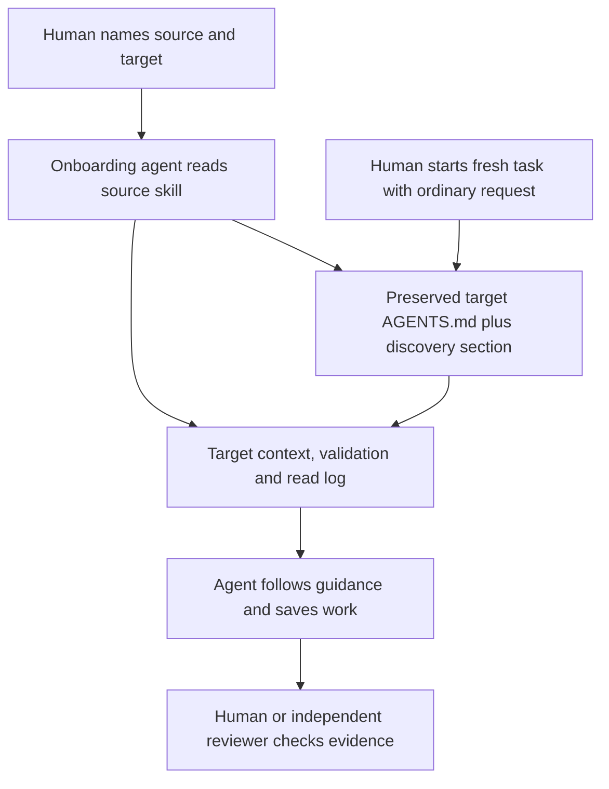

# How Valhalla Lite works

Describes source revision `426baaf9b6543ab99bd112a75d6cb7e0c3c8c369` and
[demo evidence at e5c8d1f](https://github.com/zakkriel/testing-Repo-Valhalla/blob/e5c8d1f60ef160f5a868f8b822cf2b3908ae58c2/PRODUCT-PROOF.md).

Lite is agent-followed Markdown guidance. Its source holds reusable procedures;
the target holds its own facts, discovery instructions and results. There is no
harness server, executable installer, automatic agent bootstrap or model training.

## Pieces and current status

| Piece | Purpose | Existing source or target output |
| --- | --- | --- |
| Source skill | Reusable procedure and boundaries | [Generic onboarding](../skills/valhalla-onboard/SKILL.md), [Product](../skills/valhalla-product/SKILL.md) |
| Target AGENTS.md | Discovery links and working rules, preserving prior instructions | [Actual installed sections](https://github.com/zakkriel/testing-Repo-Valhalla/blob/e5c8d1f60ef160f5a868f8b822cf2b3908ae58c2/AGENTS.md) |
| Project context | Evidence-backed facts; separate observation from intent | Product, Engineering and Testing Markdown under target `harness/` |
| Results | Durable answers, brief, checks and limitations | [Product handoff and outputs](product/README.md) |
| Read log | Full/partial receipts with purpose; privacy-safe identifiers | Target `harness/read-log.md`; compare with actual read actions |

Product has a dedicated workflow through a validated brief. Engineering and
Testing currently have context and demonstrated task behavior, **not dedicated
reusable harness skills**. See [Engineering](engineering/README.md),
[Testing and diagnosis](testing/README.md), and [proposed increments](next-iterations.md).

## Install ordering

This is the recommended, demo-tested order. The Product skill uses an existing
read log but does not explicitly make generic onboarding a prerequisite.

1. Inspect target instructions and dirty state. Obtain the source from its real
   GitHub URL in a separate checkout; verify the skill is tracked at the cited revision.
2. If the base harness is absent, use generic onboarding first. The agent inspects
   code/docs, executes relevant baseline checks, creates three context files and
   a read log, and appends the delimited `valhalla-lite` AGENTS.md section. It stops
   before changing application behavior and checks preservation/identical reapply.
3. For Product work, invoke its skill. Reconcile `harness/product.md`, add the
   validation handoff and `valhalla-product` discovery section, resolve material
   questions, update understanding, then obtain actual confirmation.
4. Start a separate fresh planning conversation. Give an ordinary feature request;
   AGENTS.md routes it to saved context. Product scope ends at a brief, before code.

Example onboarding request (supply a target location):

> Onboard Valhalla Lite from https://github.com/zakkriel/valhalla-lite into my repository. Obtain the source and use skills/valhalla-onboard/SKILL.md. Stop after onboarding.

Then follow the [Product invocation](product/README.md). These are prompts to an
agent, not installed shell commands. Opening a fresh conversation is a human/task
operation; this repository does not schedule or spawn one automatically.

## Guidance and correction

AGENTS.md and skills ask the agent to preserve constraints, read context, execute
checks and log reads. They do not enforce compliance. A log is neither telemetry
nor proof of understanding; inspect actions, output contents and acceptance evidence.
Copy the skill's privacy clause unchanged. Keep exact external-path mappings in
private session evidence outside the target; do not publish private paths or traces.

When a result is wrong, [classify the cause](testing/README.md#diagnose-before-correcting),
make the narrow correction, have a human review changed intent/instructions, and
repeat the discriminating case with a fresh task where useful. Retain old evidence
and limits. This is human-reviewed instruction/context evolution, not automatic RL.
