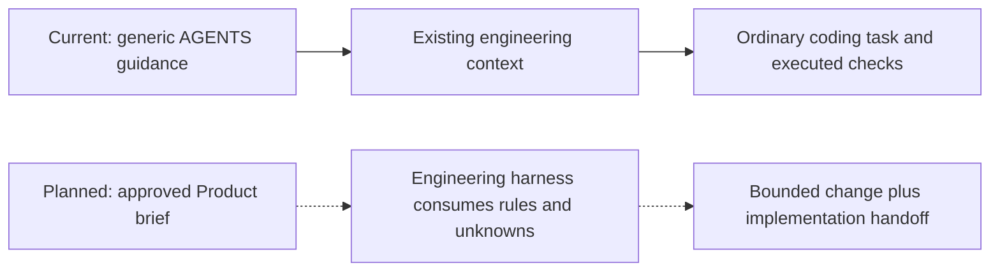

# Engineering: current context, planned harness

Current source has **no dedicated Engineering skill**. The
[generic onboarding skill](../../skills/valhalla-onboard/SKILL.md) creates implementation
context, and the generic POC demonstrated an ordinary fresh agent making a bounded
tax change. This is partial evidence, not a reusable Engineering handoff procedure.

Current artifacts: [engineering context](https://github.com/zakkriel/testing-Repo-Valhalla/blob/e5c8d1f60ef160f5a868f8b822cf2b3908ae58c2/harness/engineering.md),
[invoice CLI](https://github.com/zakkriel/testing-Repo-Valhalla/blob/e5c8d1f60ef160f5a868f8b822cf2b3908ae58c2/src/cli.mjs),
and [original POC evidence](https://github.com/zakkriel/testing-Repo-Valhalla/blob/e5c8d1f60ef160f5a868f8b822cf2b3908ae58c2/PROOF.md).
No new Engineering invocation or output schema exists to document yet.

For the demonstrated generic route, after onboarding a fresh task was asked to
add `--tax PERCENT`, preserve default output, round once on the subtotal and reject
invalid rates. The app prints $6.00 by default and $6.60 at 10% tax. Checks exercised
the real CLI; isolated original/wrong versions failed. Source instructions ask for
persisted outcomes and gaps, but execution remains agent-followed guidance.

The next proposed reusable change is a small Engineering procedure that explicitly
consumes a Product brief, distinguishes confirmed rules from proposals, stops for
material unresolved choices, and hands changed paths/check results/gaps to an
independent reviewer. It must preserve existing instructions and input data.
See [iteration proposal](../next-iterations.md); implementation awaits written-goal approval.

Do not implement the demo discount merely because its brief exists. If code
contradicts an agreed rule, correct the code and demonstrate the behavioral check.
If the rule is unresolved, return to Product. If context is stale, reconcile that
context against source evidence without silently redefining the product outcome.
