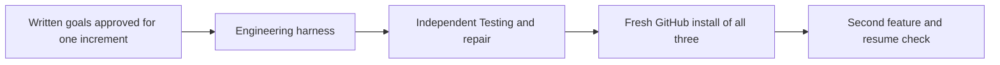

# Next iterations — proposals awaiting written-goal approval

The reusable harness change is the deliverable; a demo feature supplies evidence.
These are proposed goals, not authorization to implement them. Preserve the existing
POC and Product baselines. Keep full Valhalla paused and learning/RL in backlog.

The arrows are a suggested dependency order, not automatic orchestration.

| Increment | Reusable change to approve | Demo evidence and success condition |
| --- | --- | --- |
| Engineering | A small procedure consumes validated Product context and an authorized brief, identifies unresolved choices, implements a bounded change and persists a handoff | Resolve the selected demo brief's material policies first. A fresh engineer uses the confirmed rules, preserves constraints, executes relevant checks and records changed paths/results/gaps. A result that ignores a Product rule is detectable. |
| Independent Testing repair | A separate reviewer derives expectations from Product intent/evidence, challenges implementation, and returns a specific repair when needed | Introduce or isolate one representative wrong behavior safely. Testing identifies the violated rule and reproducible input/output; Engineering repairs it; independent retest distinguishes repaired and wrong versions. No universal test-count gate. |
| Fresh install of all three | A minimal source workflow makes Product, Engineering and Testing procedures discoverable together without hidden prepared files | Start with an uninstrumented target. An agent acquires the actual GitHub revision, preserves existing AGENTS.md, installs context/procedures, and fresh tasks complete the agreed handoffs. Trace and outcomes show use; privacy-safe logs remain corroborating evidence. |
| Second feature and resume | Reuse the same procedures and reconcile persisted state after a fresh conversation | A different bounded feature exercises a rule the first feature did not cover. Resume from saved facts/decisions/results, surface stale or conflicting guidance, and complete without repeating the whole product explanation. No feature-specific framework expansion. |

Before each increment, write its intended outcome, exact boundaries, observable
success and the concrete risk each check addresses, then obtain owner approval.
Use distinct responsibilities rather than merely moving three documents into
folders. Prefer one useful handoff and one discriminating case over new machinery.

Current starting point: [Product workflow](product/README.md) ends at a brief;
[Engineering](engineering/README.md) and [Testing](testing/README.md) are partial.
The discount interface, range, error policy and tie rule remain proposed choices.
No new feature, database, server, framework or learning experiment is authorized
by this plan.
