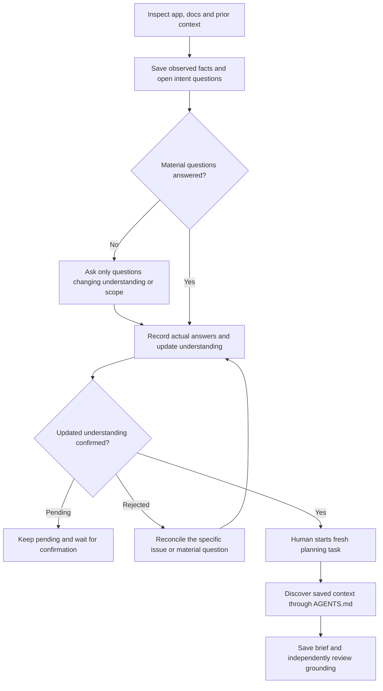

# Product harness: understand, validate, reuse

Implemented procedure: [valhalla-product](../../skills/valhalla-product/SKILL.md).
It produces a grounded feature brief; it does not implement the proposed feature.

## Inputs, outputs and handoff

The agent reads existing target instructions, code, examples, docs and relevant
checks. Code establishes what happens; it does not establish what should happen.

- `harness/product.md`: one compact understanding of users/problem, observed
  capabilities, intended rules, evidence links, assumptions and unanswered questions.
- `harness/product-validation.md`: material questions, actual answers and confirmation
  status. Update the understanding **before** seeking confirmation. Pending answers
  or a rejection must not become approval by inference.
- AGENTS.md: preserved existing instructions plus a Product discovery section,
  links to those two documents and the unchanged privacy clause. The demo uses
  delimiters and preserves an original prefix; those formatting conventions are
  not separately specified by the Product skill.
- A later feature brief under `harness/`: user outcome, scope, observable acceptance,
  evidence and unresolved choices. The filename is not a fixed schema.

To onboard Product after the base harness exists:

> Onboard the Product harness from https://github.com/zakkriel/valhalla-lite into my repository using skills/valhalla-product/SKILL.md. Inspect the product, record material questions, and stop pending validation. Do not implement app features.

After answers, reconciliation and confirmation, a fresh task can receive:

> Plan percentage discount support for the invoice CLI. Write a short feature brief with the intended user outcome, scope, observable acceptance and unresolved decisions. Do not code.

## Small example and limits

The demo's [saved understanding](https://github.com/zakkriel/testing-Repo-Valhalla/blob/e5c8d1f60ef160f5a868f8b822cf2b3908ae58c2/harness/product.md)
distinguishes existing tax support from intended future reductions. Its
[validation](https://github.com/zakkriel/testing-Repo-Valhalla/blob/e5c8d1f60ef160f5a868f8b822cf2b3908ae58c2/harness/product-validation.md)
uses an explicitly synthetic owner fixture, not real-owner approval. A fresh task's
[brief](https://github.com/zakkriel/testing-Repo-Valhalla/blob/e5c8d1f60ef160f5a868f8b822cf2b3908ae58c2/harness/percentage-discount-brief.md)
applies confirmed reduction-before-tax intent but marks the discount flag, rate
range and tie rule as proposals. Do not promote those choices into implementation
requirements without the necessary decisions and authorization.

Its [independent review](https://github.com/zakkriel/testing-Repo-Valhalla/blob/e5c8d1f60ef160f5a868f8b822cf2b3908ae58c2/harness/product-brief-review.md)
checks content and arithmetic against confirmed facts, rather than treating reads
as understanding. One synthetic product does not establish real customer intent,
production adoption or a causal advantage over working without context.
