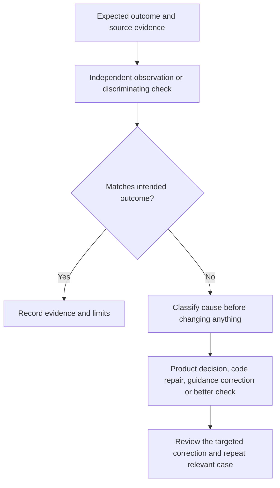

# Testing: observed checks, planned independent harness

Current source has **no dedicated Testing skill or enforcement runner**. Generic
guidance asks agents to choose discriminating checks and persist results. The demo
has [six app tests](https://github.com/zakkriel/testing-Repo-Valhalla/blob/e5c8d1f60ef160f5a868f8b822cf2b3908ae58c2/test/invoice.test.mjs),
[testing context/results](https://github.com/zakkriel/testing-Repo-Valhalla/blob/e5c8d1f60ef160f5a868f8b822cf2b3908ae58c2/harness/testing.md),
and separate review evidence. They are partial foundations for a Testing harness.

This is a review/correction model; it is not an implemented automatic task router.
Run `node --test` from the demo repository root to exercise its existing tests.
Do not claim those tests execute a discount feature: that feature remains a brief.

## Diagnose before correcting

| Evidence | Likely cause to investigate | Targeted correction |
| --- | --- | --- |
| Agreed $6.60 tax example produces $6.00 | Code defect, if the agreed rule and input are unchanged | Locate calculation/argument fault; repair code; rerun the distinguishing CLI assertion and relevant regression check |
| Half-cent discount tie handling is undecided | Product ambiguity | Obtain a decision; update intended rules and acceptance; do not present an implementation choice as owner intent |
| Context conflicts with current code or points to an untracked skill at an old revision | Stale/conflicting guidance or provenance | Compare the actual sources and authority; reconcile the specific document/link; verify tracked revision and fresh discovery |
| A wrong order still passes the chosen example | Inadequate check | Choose an input that separates the outcomes, rather than adding unrelated tests |

These causes can coexist. Diagnose from actual inputs, outputs and confirmed intent;
do not assume every bad result is an instruction defect. A test failure alone does
not decide which product rule is correct.

## One useful discriminator

The proposed discount brief uses a 10-cent subtotal with 5% discount and 5% tax.
Under its **proposed** half-up tie policy, reducing before tax yields 9 cents;
taxing first then discounting the tax-inclusive amount yields 10 cents. The larger
600-cent/10%/10% example gives 594 cents under both orders and would miss that error.
This is arithmetic review of proposed acceptance, not executed discount behavior.

The [Product proof](https://github.com/zakkriel/testing-Repo-Valhalla/blob/e5c8d1f60ef160f5a868f8b822cf2b3908ae58c2/PRODUCT-PROOF.md)
preserves a provenance correction and a reviewer arithmetic slip. The
[original proof](https://github.com/zakkriel/testing-Repo-Valhalla/blob/e5c8d1f60ef160f5a868f8b822cf2b3908ae58c2/PROOF.md)
preserves an external-path logging failure, explicit privacy-clause repair, and
a successful fresh follow-up. Neither establishes universal future compliance.

For instruction/context evolution: retain the failing evidence, propose the narrow
edit, obtain human review of changed intent/instructions, try a fresh relevant task,
and compare actual behavior. Do not rewrite failed history or infer understanding
from log counts. Keep raw traces/private path mappings outside public repositories.
Learning/RL remains backlog; this is a human-reviewed correction loop.
